# Azure Essentials - Project 01
# Azure Cost Visibility Dashboard

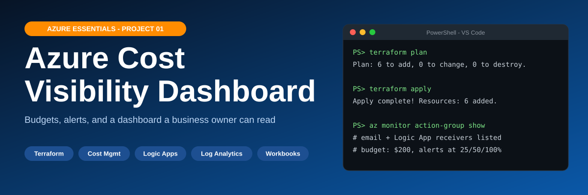

---

## What This Lab Is

Most small businesses move to the cloud and then get bills full of line items nobody can read or predict. This project builds the fix with Terraform: a monthly budget that watches the spend, email alerts at $50, $100, and $200, a Logic App that sends the alert, and a dashboard in Azure Workbooks. The goal is simple. A business owner sees what they are spending and hears about it before the bill is a problem.

## Watch Me Build This Lab

[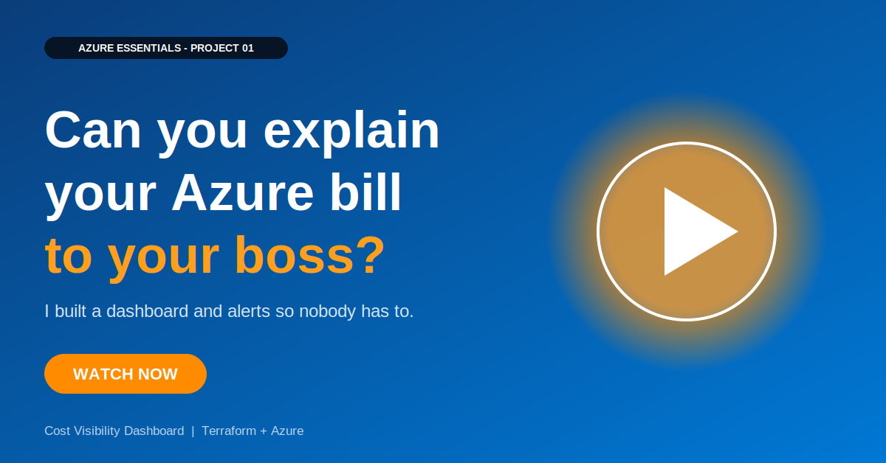]([Loom link])

[Watch the full walkthrough on Loom]([Loom link])

## What You Will Build


<details>
<summary>Text version of the diagram</summary>

```
Subscription
  Budget ($200 / month) --> 25% ($50) / 50% ($100) / 100% ($200)
        |
        v
rg-cost-dashboard-giovanni (East US)
  Action Group --> email to owner
        |--> Logic App (HTTP trigger --> Send email)
  Subscription Activity Log --> Diagnostic Setting --> Log Analytics (30 days)
        |
        v
  Azure Workbook (Cost Visibility Dashboard)
```

</details>

## Skills You Will Practice

| Skill | Tool |
|---|---|
| Infrastructure as code | Terraform (azurerm 3.x) |
| Cost control and budgets | Azure Cost Management |
| Alert routing | Azure Monitor Action Groups |
| Low-code automation | Azure Logic Apps |
| Log collection | Diagnostic Settings, Log Analytics |
| Reporting | Azure Workbooks |
| Secure sign-in | Azure CLI device code flow |

## Cost

Close to zero for a short lab. Budgets and action groups are free. Log Analytics bills per GB ingested and Logic Apps bill per run, both tiny at lab scale. Run `terraform destroy` when you finish.

## Time

3 to 4 hours.

## Prerequisites

- An Azure subscription (Owner or Contributor, plus Cost Management access for budgets)
- Terraform, Azure CLI, Git, and VS Code
- An email address for the alerts
- A Gmail (or other personal) account the Logic App can sign in to. Office 365 Outlook needs an Exchange mailbox and failed with a 401 in this build

## Quick Start

```powershell
. .\set-vars.ps1
az login --use-device-code
Copy-Item terraform.tfvars.example terraform.tfvars
# edit terraform.tfvars with your email, then:
terraform init
terraform plan
terraform apply
```

Then follow Phases 7 and 8 in [the SOP](docs/Project01-Cost-Dashboard-SOP.md) to build the Logic App steps and the Workbook in the portal.

## Security Flags Applied

| Flag / Setting | Why |
|---|---|
| `terraform.tfvars` in `.gitignore` | Keeps your email out of GitHub |
| Logic App trigger URL never saved | The URL carries a secret signature (`sig=`) |
| `Read-Host -MaskInput` and `--output none` | Hides the URL while pasting and stops `az` printing it back |
| `az login --use-device-code` | No browser popup, no stored tokens in the repo |
| `retention_in_days = 30` | Old log data is deleted automatically |

## Verify It Works

```powershell
az resource list --resource-group $RG --output table
```

Expect the workspace, action group, and Logic App. The budget and diagnostic setting live at subscription level, so check the budget with:

```powershell
az consumption budget show --budget-name $BUDGET --output table
```

Confirm the action group has both receivers. Use this filtered version only, because a plain `show` prints the signed callback URL:

```powershell
az monitor action-group show --name $AG --resource-group $RG --query "{emails:emailReceivers[].emailAddress, logicApps:logicAppReceivers[].name}" --output json
```

Then in the portal, run **Test action group** on `ag-cost-alerts-giovanni`, select both the email and the Logic App, and confirm two things: the action group email arrives, and the Logic App **Run history** shows a **Succeeded** run with a second email titled `Azure Cost Alert - Budget Threshold Reached`.

## Screenshots

The subscription ID and email address are blocked out. The Logic App signed URL never appears.

**Build**

| Step | Screenshot |
|---|---|
| Resource group after `terraform apply` | 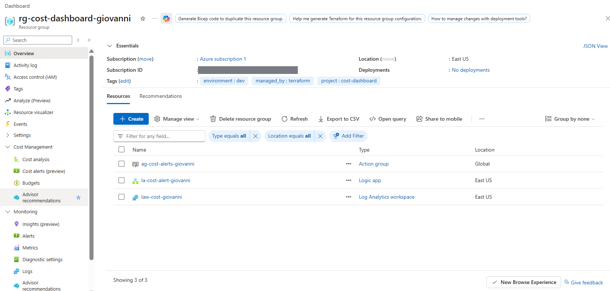 |
| Empty Logic App before the designer steps | 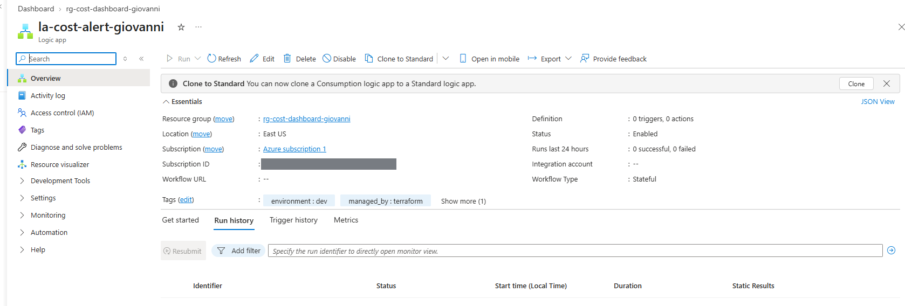 |
| HTTP trigger added (URL appears only after save) | 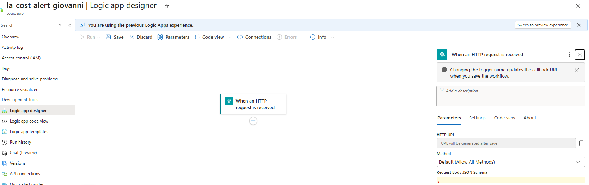 |
| Office 365 Outlook attempt (failed with a 401, no Exchange mailbox) | 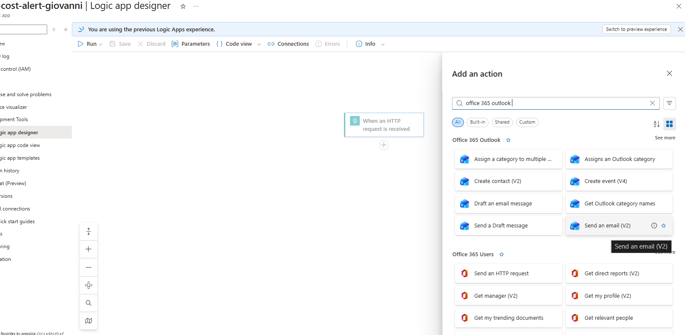 |
| Gmail Send email (V2) step, the fix | 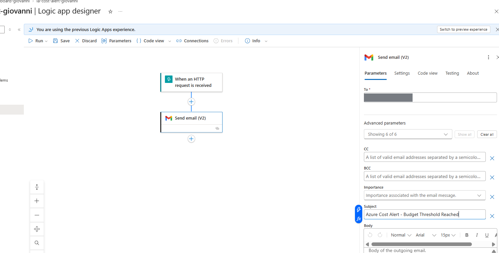 |
| CLI check: email and `la-webhook` both registered | 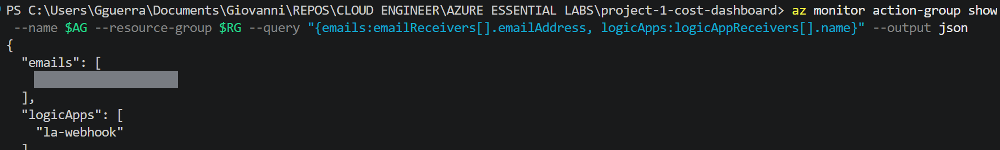 |

**Email verification**

| Step | Screenshot |
|---|---|
| Action group email shows Pending | 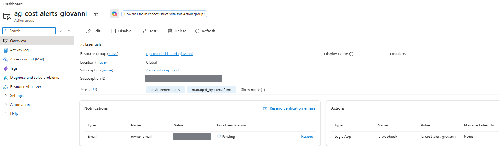 |
| First verification link had expired | 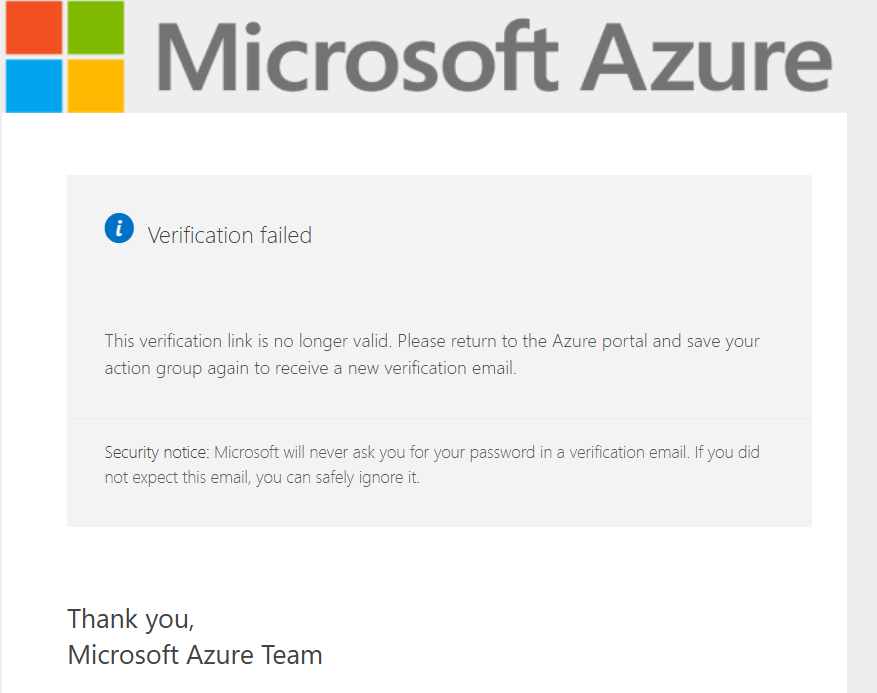 |
| After a resend, the email shows Verified | 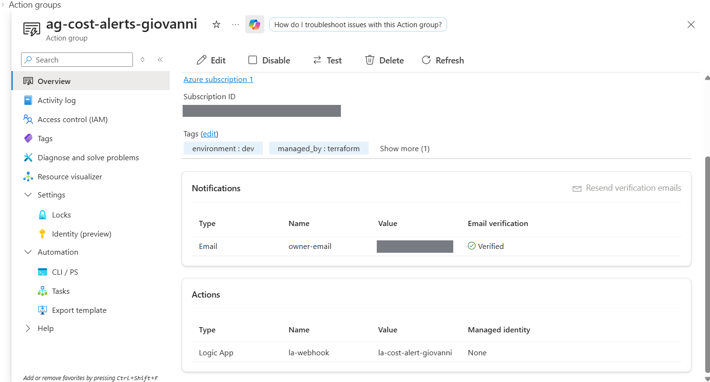 |

**Proof it works**

| Step | Screenshot |
|---|---|
| Test action group | 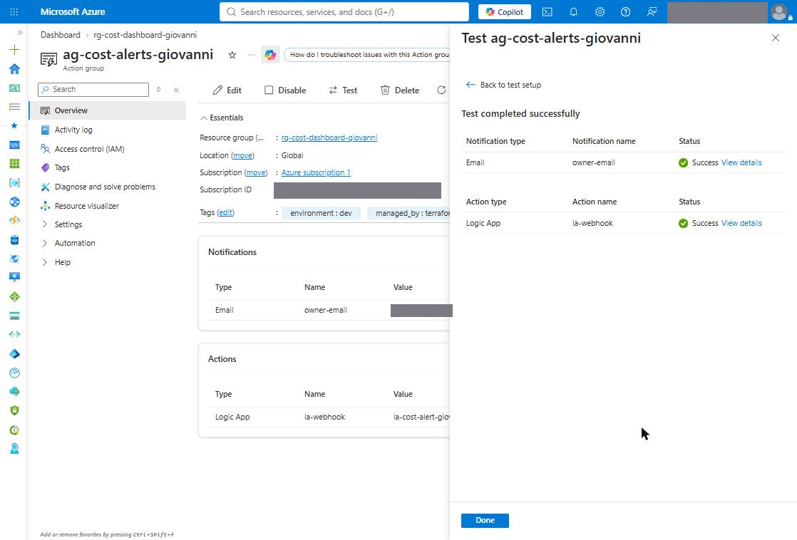 |
| Action group sample budget alert email | 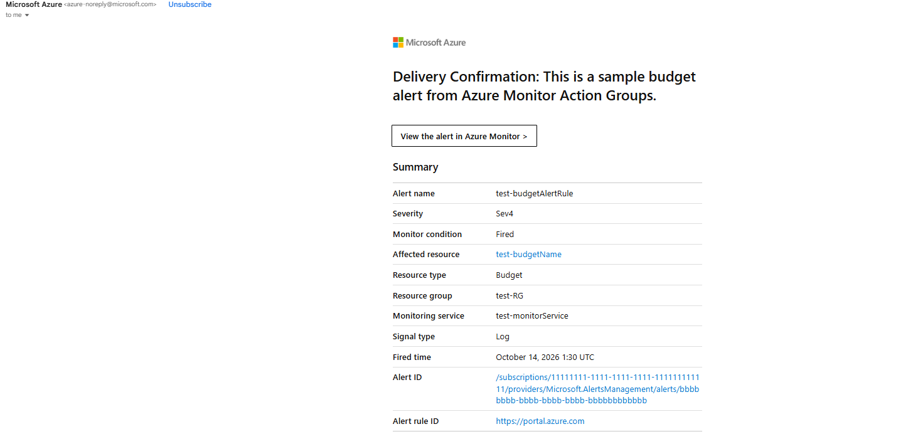 |
| Logic App alert email in Gmail | 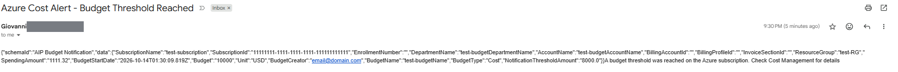 |
| Logic App run history, all Succeeded | 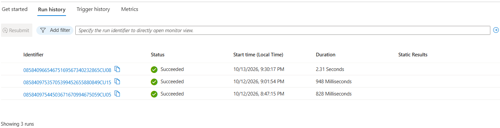 |
| Action group Actions tab with `la-webhook` | 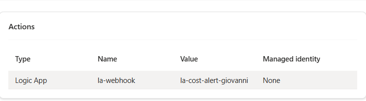 |

**Dashboard and budget**

| Step | Screenshot |
|---|---|
| Cost Visibility Dashboard workbook | 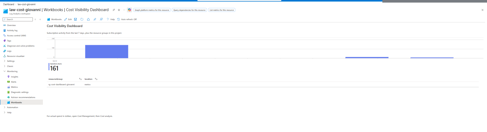 |
| Budgets at subscription scope | 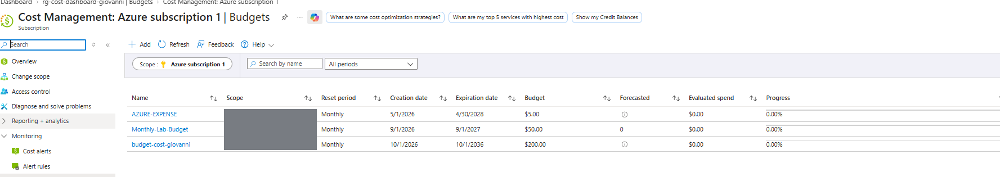 |
| Budget alert conditions: 25% ($50), 50% ($100), and 100% ($200) | 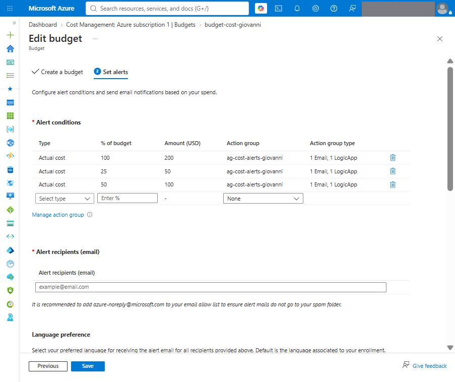 |
| Final resource group with all five resources | 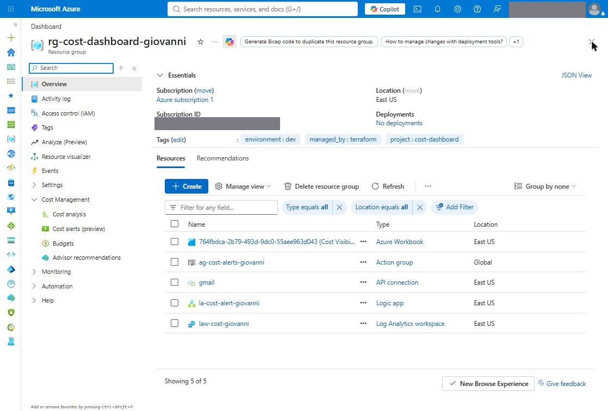 |

**Final verification (Phase 9)**

| Step | Screenshot |
|---|---|
| Action group email shows Verified | 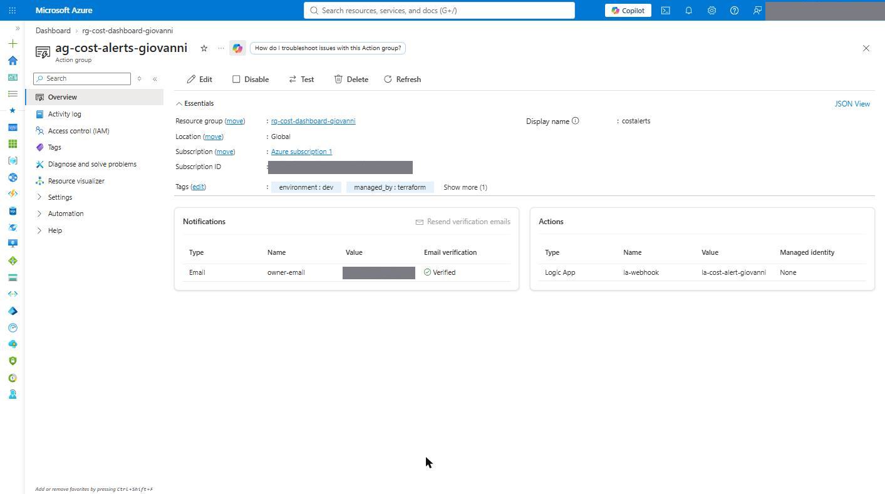 |
| Logic App designer: HTTP trigger plus Gmail Send email (V2) | 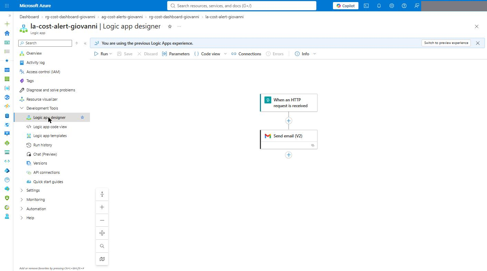 |
| Logic App Enabled, with four Succeeded runs in Run history | 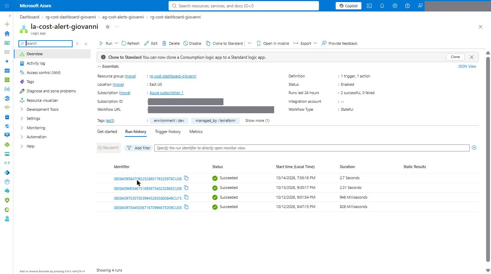 |

## Project Structure

```
azure-cost-dashboard/
├── README.md                      this file
├── main.tf                        all Azure resources
├── variables.tf                   inputs (name, region, email, budget start date)
├── outputs.tf                     values printed after apply
├── terraform.tfvars.example       copy to terraform.tfvars and fill in
├── set-vars.ps1                   names used by the commands
├── .gitignore                     keeps secrets and state out of Git
├── assets/
│   ├── architecture.svg           animated diagram
│   ├── architecture.png           static copy
│   ├── screenshots/               proof screenshots
│   └── thumbnails/                LinkedIn images (detailed and generic sets)
├── linkedin/
│   └── Project01-LinkedIn-Posts.md
└── docs/
    ├── Project01-Cost-Dashboard-SOP.md
    └── Project01-Cost-Dashboard-SOP.docx
```

## What Went Wrong and What I Learned

| Problem | Cause | Fix |
|---|---|---|
| Office 365 Outlook step returned 401 | The tenant has no Exchange Online mailbox | Switched to the Gmail connector |
| Gmail step returned 403 insufficient scopes | Not every permission box was ticked at sign-in | Signed in again with all permissions ticked |
| `az monitor action-group update` saved a broken Logic App receiver | On Windows, the signed URL is split at every `&` | Added the Logic App through the portal instead |
| `az monitor action-group show` said `Missing required field: -n` | Variables were not loaded, so `--name` and `--resource-group` were empty | Ran `. .\set-vars.ps1` first |
| Signed Logic App URL was exposed while troubleshooting | URL was pasted into a chat | Rotated the access key and re-saved the action group action |

**Terraform drift:** the Logic App receiver on the action group, the workbook, and the Gmail connection were all created by hand in the portal. Terraform does not know about them, so `terraform plan` would try to remove the receiver. After the portal steps I did not run `apply` again. For a production build, the receiver belongs in `main.tf` as a `logic_app_receiver` block so the code and the portal agree.

**Proof the alert chain works:** a Test action group run on Oct 13 produced the action group confirmation email, a Succeeded Logic App run, and the Logic App's own Gmail alert.

## Clean Up

List the resource group first. The workbook and the email connection were made by hand in the portal, so Terraform does not know about them. Delete those in the portal, then run the destroy below. Do not run `terraform apply` after Phase 7, because the portal-added Logic App receiver would be removed.

```powershell
terraform destroy
```

Nothing later in the series depends on this project.

## LinkedIn Post Series

| # | Post | Thumbnail | Generic alternate |
|---|---|---|---|
| 1 | [Watch the walkthrough]([Loom link]) | [post1-loom](assets/thumbnails/png/post1-loom.png) | [g1-watch](assets/thumbnails/generic/png/g1-watch.png) |
| 2 | The GitHub repo | [post2-github](assets/thumbnails/png/post2-github.png) | [g2-github](assets/thumbnails/generic/png/g2-github.png) |
| 3 | One thing I learned | [post3-learned](assets/thumbnails/png/post3-learned.png) | [g3-learned](assets/thumbnails/generic/png/g3-learned.png) |
| 4 | What I'd do differently | [post4-different](assets/thumbnails/png/post4-different.png) | [g4-different](assets/thumbnails/generic/png/g4-different.png) |

## Part of the Azure Essentials Series

| Project | Topic | Repo |
|---|---|---|
| **Project 1** | **Azure Cost Visibility Dashboard** | **[azure-cost-dashboard](https://github.com/Gguerra4networks/azure-cost-dashboard)** |
| Project 2 | Automated Backup System | [Project-2-Automated-Backup-System](https://github.com/Gguerra4networks/Project-2-Automated-Backup-System) |
| Project 3 | Website Uptime Monitor | [project3_uptime_monitor](https://github.com/Gguerra4networks/project3_uptime_monitor) |

## Acronyms and Terms

**What:** A list of the short names and special words used in this lab.
**Why:** Cloud work is full of abbreviations. If a word looks strange, look it up here instead of guessing. The short names come first, then the special words.

| Term | Stands for | In plain words |
|---|---|---|
| AG | Action Group | A short name used in commands. `$AG` holds the name of your action group, so you do not have to retype it. |
| API | Application Programming Interface | A set of rules that lets one program talk to another. Terraform uses Azure's API to build things for you. |
| CLI | Command-Line Interface | A way to control a program by typing commands instead of clicking. The Azure CLI command is `az`. |
| GB | Gigabyte | A measure of how much data is stored. |
| HTTP | HyperText Transfer Protocol | The language that web pages and web services use to talk to each other. |
| ID | Identification | A unique number or name that points to exactly one thing, like a subscription ID. |
| IT | Information Technology | Computers, networks, and the people who keep them working. |
| JSON | JavaScript Object Notation | A neat text format that stores information as labels and values. |
| POST | HTTP POST | A kind of web message that carries information to an address. Azure sends a POST to hand the alert to the Logic App. |
| RG | Resource Group | A short name used in commands. `$RG` holds the name of your resource group. |
| SOP | Standard Operating Procedure | A step by step instruction sheet that anyone can follow. |
| URL | Uniform Resource Locator | A web address. |
| V2 | Version 2 | The second version of something. "Send email (V2)" is the newer version of the Send email step. |
| VS Code | Visual Studio Code | A free program for writing and editing code and text files. |
| Azure | - | Microsoft's cloud. That means computers and services you rent over the internet instead of owning. |
| Subscription | - | Your Azure account for billing. Everything you build is billed to it. |
| Tenant | - | Your organization's private space inside Microsoft's sign-in system. |
| Resource group | - | A folder that holds all the pieces of one project, so you can manage or delete them together. |
| Terraform | - | A tool where you write what you want in text files and it builds it for you. |
| Infrastructure as code | - | Describing your cloud setup in files, so you can rebuild the exact same thing any time. |
| Budget | - | A monthly spending limit in Azure. It warns you when spending gets close. It does not stop the spending. |
| Alert | - | A message that says something needs your attention, like spending just hit $50. |
| Action group | - | A list of who or what to tell when an alert goes off. |
| Logic App | - | A small automation that does steps for you. Here, when it gets the alert, it sends an email. |
| Connector | - | A ready-made piece that lets a Logic App talk to another service, like Gmail. |
| Webhook | - | A web address that another program can send a message to, so it starts something. |
| Signed URL | - | A web address with a secret password built into it (the `sig=` part). Anyone who has it can use it, so never share it. |
| Log Analytics workspace | - | A storage place where logs are kept so you can search them. |
| Diagnostic setting | - | A switch that sends activity records to the place that stores them. |
| Activity log | - | A diary of what happened in your Azure subscription. |
| Workbook | - | A dashboard page in Azure Monitor made of charts and tables. |
| Dashboard | - | One page that shows the important numbers so you can see them at a glance. |
| State file | - | Terraform's notebook of what it built (`terraform.tfstate`). Never share it, because it can hold private details. |
| Drift | - | What happens when someone changes a thing by hand in the portal, so it no longer matches the code. |
| Apply and destroy | - | `terraform apply` builds what your files describe. `terraform destroy` deletes all of it. |
| Device code sign in | - | Signing in by typing a short code on a web page, instead of using a popup window. |
| Redact | - | Covering up private details in a screenshot, so nobody can read them. |

## Author

**Giovanni Guerra** - Radio Network Infrastructure Specialist moving into cloud security and federal IT.
[GitHub](https://github.com/Gguerra4networks) | [LinkedIn](https://www.linkedin.com/in/giovanni-giovanni)
